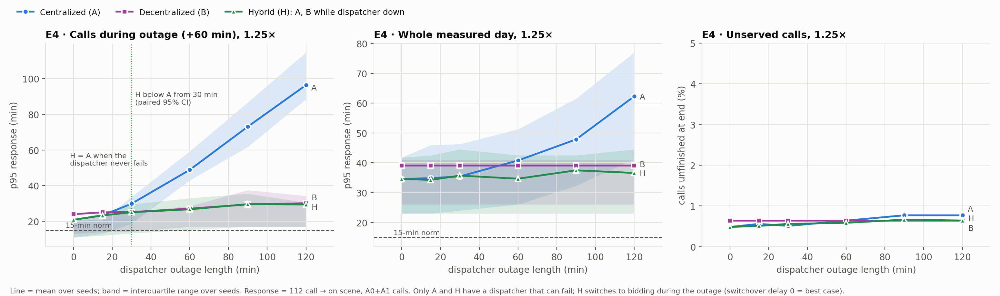
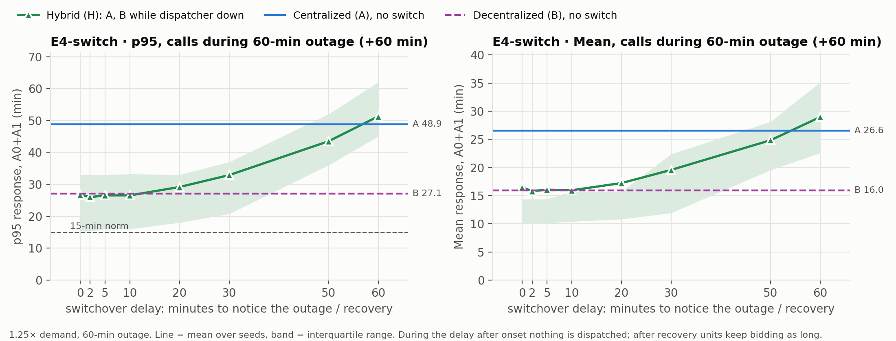
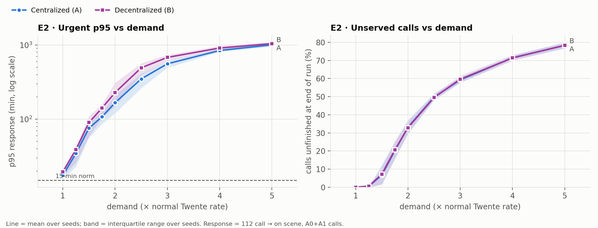
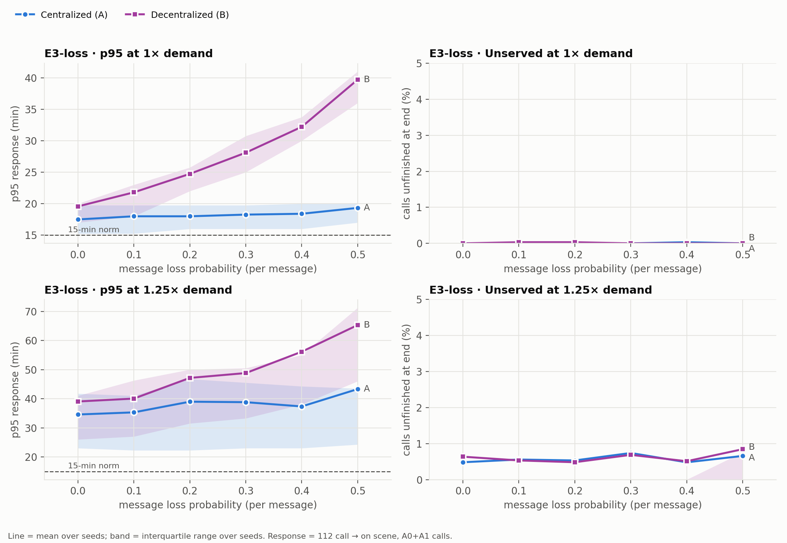
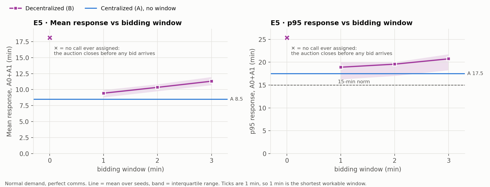
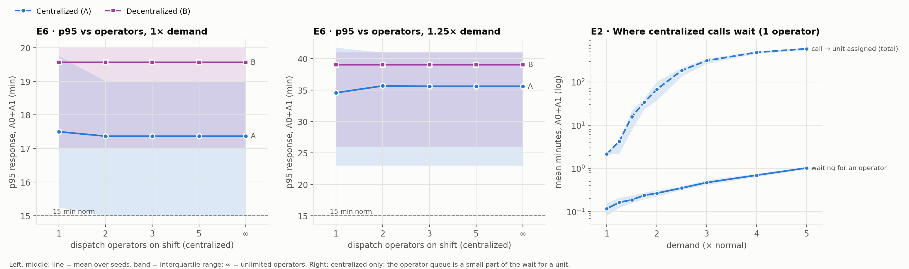

# Twente ambulance dispatch — centralized vs decentralized (agent-based model)

A Mesa simulation of urgent ambulance care in RAV Twente: 11 ambulance posts and the two 24/7
emergency departments (MST Enschede, ZGT Almelo). It compares two ways of allocating ambulances
on identical emergencies, both serving the most urgent calls first:

* **Centralized:** a control room with a limited number of operators processes each call and sends the
  nearest free ambulance.
* **Decentralized:** no dispatcher; ambulances bid their arrival time (Contract Net).

These are tested under rising demand, lost or delayed messages, a control-room outage, different
bidding windows and different numbers of operators.

**Short answer:** central dispatch wins in everyday conditions and under load, even with one operator on
shift; an urgency-ordered auction is a plausible backup when the dispatcher is down for half an hour or more.
A hybrid (`mode="hybrid"`: central dispatch, auction only during an outage; tested in E4 only) keeps the
everyday performance and removes most of the outage cost, assuming the switch is noticed quickly. Details: [`module/docs/RESULTS_SUMMARY.md`](module/docs/RESULTS_SUMMARY.md).

## Main findings

Each setting ran on 30 simulated days. p95 is the response time of the slowest 5% of urgent (A0+A1) calls,
measured from the 112 call. Outage results are at 1.25× normal demand.

| Situation | Centralized | Auction | Hybrid |
|---|---|---|---|
| Normal day, p95 | **17.5 min** | 19.6 min | same as centralized |
| 2× demand, p95 | **167 min** | 229 min | not tested |
| 50% of messages lost, p95 | **19.3 min** | 39.7 min | not tested |
| 60-min control-room outage, p95 (calls during it and the hour after) | 48.9 min | 27.1 min | **26.7 min** |
| Messages per day, normal demand | **119** | 1,355 | not tested |

The hybrid's outage result assumes an instant switch, and that crews can still exchange messages and
112 calls still get in. The model uses an abstract map and idealised operators, so these are model
results, not predictions for the real region. See the
[limitations](module/docs/RESULTS_SUMMARY.md#main-limitations).

## Key figures

Blue is centralized (A), purple is the auction (B) and green is the hybrid (H). Lines are the mean over
30 days, shaded bands are the middle 50% of days, and the dashed line is the 15-minute norm.

**Control-room outage: the one case where the auction wins.** Centralized calls pile up while the
dispatcher is down, and the auction has no central point to lose. The hybrid matches centralized when
nothing fails and matches the auction during an outage. Unserved calls barely differ.



**Switchover delay: how fast the fallback must start.** For a 1-hour outage, switching within 10 min
keeps all of the gain, 30 min keeps about 70% and 50 min about a quarter. A switch that comes only once the
control room is back is slightly worse than no fallback.



**Rising demand: hospitals become the limit.** Centralized is faster for urgent calls at every demand
level. From about 1.5× demand the emergency departments are full, and both modes leave the same share of
calls unserved.



**Message loss: the auction needs good communication.** It uses three messages per call (announce, bid,
award) where the dispatcher uses one, so its p95 roughly doubles at 50% loss.



**Bidding window: the auction's everyday cost.** The mean penalty equals the window, minute for minute. A
zero window never works, because the auction closes before any bid arrives.



**Operators: staffing is not the bottleneck.** One operator performs about the same as unlimited operators.
Even at 5× demand, urgent calls wait about 1 min for an operator, against hundreds of minutes for an
ambulance. The operators are idealised, so this is a best case for the control room.



## What's in this repository

| Folder | What it is |
|---|---|
| [`module/`](module/) | The Mesa simulation, experiments and results. Its [README](module/README.md) explains how to run them and reproduce the study. |
| [`conversational-agent/`](conversational-agent/) | A voice agent that takes an emergency call and produces an incident, which the simulation can then run. Setup is below. |

## Setup & Run (voice agent)

### Prerequisites

- Python 3.11+
- Node.js 20.19+
- [Docker Desktop](https://www.docker.com/products/docker-desktop/), running
- Chrome or Edge
- API keys: Deepgram, Gemini (Google AI Studio), TypeSafe/Jev

### 1. Clone

```bash
git clone <repository-url>
cd decentralised-ambulance-and-hospital-coordination/conversational-agent
```

### 2. Configure

```bash
cp .env.example .env
```

In `.env`, fill in `DEEPGRAM_API_KEY`, `GEMINI_API_KEY` and `JEV_API_KEY`.
`MONGODB_URI=mongodb://localhost:27017` is already set for the local Docker MongoDB. Replace it only if you use MongoDB Atlas.

### 3. Start MongoDB

With Docker Desktop open, run this in `conversational-agent/`:

```bash
docker compose up -d
```

### 4. Start the backend (terminal 1)

```bash
cd conversational-agent/backend
python3 -m venv .venv
source .venv/bin/activate        # Windows: .venv\Scripts\activate
pip install -r requirements.txt
uvicorn main:app --reload --port 8000
```

### 5. Start the frontend (terminal 2)

```bash
cd conversational-agent/frontend
npm install
npm run dev
```

### 6. Use it

Open http://localhost:5173, click **Start conversation** and allow the microphone.

### Stop

- Backend and frontend: `Ctrl+C`
- MongoDB: `docker compose down` in `conversational-agent/`

### Next time

Start Docker Desktop, then:
- `docker compose up -d`
- `source .venv/bin/activate && uvicorn main:app --reload --port 8000` in `backend/`
- `npm run dev` in `frontend/`

### Tests

```bash
cd conversational-agent/backend && source .venv/bin/activate && pytest
```
